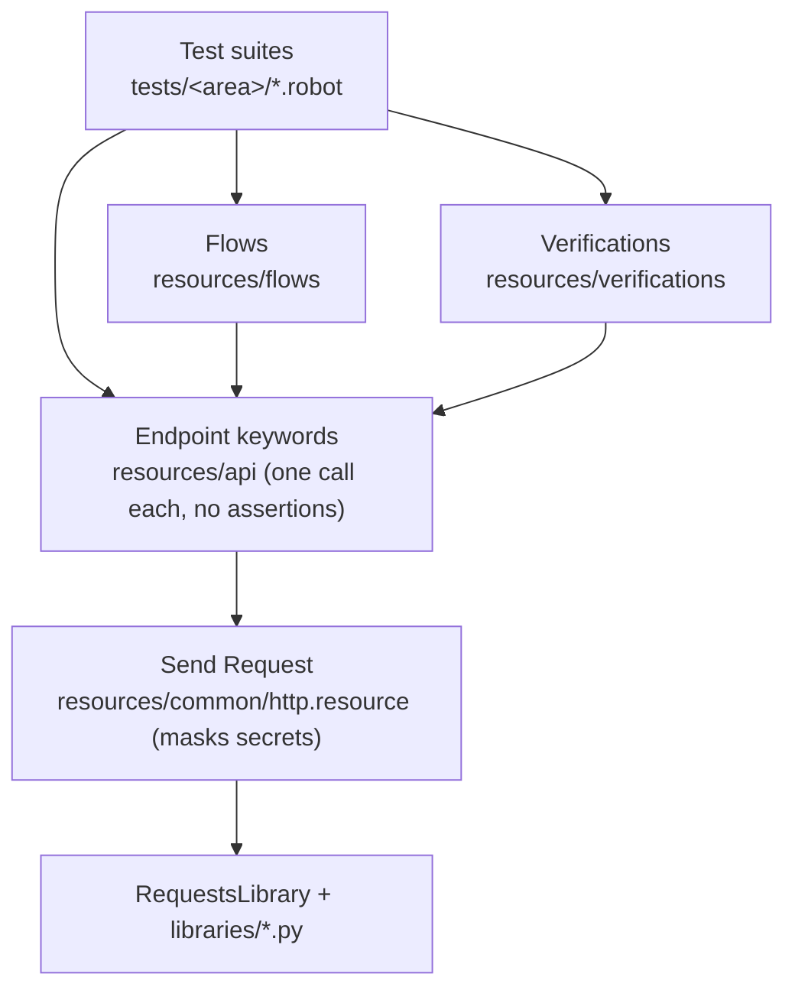

# ServeRest API Test Automation

[](https://github.com/dmacedo-qa/serverest-robot-automation/actions/workflows/tests.yml)

API tests for [ServeRest](https://github.com/ServeRest/ServeRest), an open-source REST API that
simulates an online store (users, products, carts). Written in Robot Framework with
RequestsLibrary, running against a pinned ServeRest 3.2.2 in Docker.

- [Latest test report](https://dmacedo-qa.github.io/serverest-robot-automation/): results of the last run on `main`, published by CI
- [Test plan](docs/test-plan.md): 127 cases, how they were designed, and the defects found
- [Architecture](docs/architecture.md): layers, conventions, and how test data is handled

## Defects found

Each one is reproduced by an automated test. Those tests assert the correct behavior, so they
show up as SKIP (`known-defect`) in the report instead of breaking the build.

| Severity | Defect | Test |
|---|---|---|
| Critical | A cart can hold the same product twice if the lines aren't next to each other. With `[A, B, A]` the API accepted 8 units of a product with 5 in stock, and only took 4 out of stock. | DQ-07 |
| Critical | `GET /usuarios?password=...` does a case-insensitive partial match on passwords, with no authentication | SEC-04 |
| High | `GET /usuarios` returns every user's password in plain text | SEC-01 |
| High | The JWT payload contains the user's password | SEC-02 |
| High | Any anonymous request can delete any user | SEC-03 |
| High | Anyone can register as an admin | SEC-07 |
| Medium | Email and product-name uniqueness are case-sensitive: `A@x.com` and `a@x.com` become two accounts | DQ-01, DQ-02 |
| Medium | Names made only of spaces are accepted; a product gets stored with an empty name | DQ-04, DQ-05 |
| Medium | The Swagger disagrees with the API in four places: a field name, an undocumented field, a filter limit, and undocumented status codes | DRIFT-01 to 04 |
| Low | Numbers sent as text are accepted; PUT accepts malformed IDs and ignores the ID it was given | DQ-03, DQ-06, DQ-09, DQ-10 |

## How I approached it

I started from what would actually hurt a store: charging the wrong amount, selling stock that
doesn't exist, leaking customer data, and letting the wrong person change things. Those risks set
the priorities. Anything touching money or stock is Critical or High.

The Swagger only tells part of the story. It lists routes and response shapes, but almost none of
the validation rules, so I also read the ServeRest source at the tagged version and used it to
form hypotheses. Nothing went into the plan until I'd confirmed it against the running API.
A few examples:

| What I saw in the code | What I expected | What happened |
|---|---|---|
| The duplicate-product check calls `.sort()` on an array of objects and then compares neighbors | `[A, B, A]` gets through | It does: oversell (DQ-07) |
| User filters turn `nome` and `password` into regex searches | Users can be found by part of their password | They can (SEC-04) |
| The token holds email + password, and the admin flag is read from the database on each request | A password change kills old tokens; demoting an admin takes effect immediately | Both work correctly, so they became regression tests (TOK-08, TOK-09 in the plan) |
| Email validation uses Joi with TLD checking | Reserved test domains like `@example.test` are rejected | They are, so generated data uses `@example.com` |

When the API does something a real store shouldn't (returning passwords, for example), the test
asserts what should happen and is tagged `known-defect`. If ServeRest fixes it, the test starts
passing without changes.

Test design techniques used: equivalence partitioning, boundary values (price 0 / 1 / 2⁵³−1 /
2⁵³+1, quantity equal to stock and stock + 1), a decision table for route × role, state
transitions for the cart and token lifecycles, and JSON Schema contract checks.

Out of scope on purpose: load testing (the public instance forbids it), race conditions between
buyers, and the web front end.

## Running the tests

Docker is the only requirement:

```bash
git clone https://github.com/dmacedo-qa/serverest-robot-automation.git
cd serverest-robot-automation
docker compose run --rm tests
```

This starts two ServeRest containers (the second one issues 5-second tokens for the expiry test),
waits for them, runs the suite, and writes `results/report.html` and `results/log.html`.
Stop everything with `docker compose down`. After changing code, add `--build` so the image is
rebuilt.

A full run takes about 15 seconds, 6 of which are the expiry test waiting for a token to run
out. Expected result today: 128 tests, 109 passed, 19 skipped (the known defects).

### Choosing what to run

Tests carry tags for type, priority, and area, plus the test-plan ID. A pre-run check fails any
test that's missing its type, priority, or ID, so a filter can't silently skip one.

```bash
docker compose run --rm tests --include smoke tests             # critical path, about a second
docker compose run --rm tests --include negative tests          # or positive, edge, security, contract, e2e
docker compose run --rm tests --include priority:critical tests
docker compose run --rm tests --include cartsANDnegative tests  # combine with AND / OR / NOT
docker compose run --rm tests --include known-defect tests      # only the open defects
```

| Group | Tags |
|---|---|
| Execution | `smoke`, `regression` (every test) |
| Type | `positive`, `negative`, `edge`, `contract`, `security`, `e2e` |
| Priority | `priority:critical`, `priority:high`, `priority:medium`, `priority:low` |
| Area | `auth`, `users`, `products`, `carts`, `platform` (set by the folder) |
| Status | `known-defect` |

<details>
<summary>Running with Python instead of the test container</summary>

```bash
docker compose up -d serverest serverest-short-token
python3.13 -m venv .venv
source .venv/bin/activate
pip install -r requirements.txt

robot --argumentfile config/robot.args tests/
pabot --processes 4 --argumentfile config/robot.args tests/
robot --argumentfile config/robot.args --variable DATA_SEED:81714172 tests/   # replay a run's data
robocop check resources tests                                                  # lint
```

pabot starts its workers with the `python` on your PATH, so activate the virtual environment first.
</details>

## How it's organized

A test talks to the API through four layers, and each layer only uses the one below it:



```
tests/
  __init__.robot     HTTP session, cleanup after every test, regression tag
  auth/ users/ products/ carts/ contract/ e2e/
resources/
  main.resource      the one import every test file uses
  api/  flows/  verifications/  common/
libraries/           data factory, cleanup registry, JWT forging, JSON Schema checks, tag policy
data/                expected API messages, JSON Schemas
config/              dev and ci settings, shared robot options
docs/                test plan, architecture
```

A few things the framework takes care of:

- Every test creates its own users and products and deletes them afterwards, even if it fails
  halfway. The last teardown warns if a test user is still around.
- Emails and product names are unique per run and per parallel worker. Generated content is
  seeded, and the seed is in the log, so a run's data can be replayed.
- Passwords and tokens never appear in `log.html`. They're kept as Robot `Secret` values and
  masked in the request log.

### Adding a test

Put it in the folder for its area, import `main.resource`, and tag it with the plan ID, one type,
and one priority. Session setup, cleanup, and the area tag are inherited.

```robotframework
*** Settings ***
Resource            ../../resources/main.resource

*** Test Cases ***
USR-10 Duplicate Email Is Rejected
    [Tags]    USR-10    negative    priority:critical
    ${existing}=     Register User
    ${duplicate}=    Generate User    email=${existing}[email]

    ${response}=     POST User    ${duplicate}
    Register Response For Cleanup    user    ${response}

    Request Should Fail With    ${response}    400    ${MSG.users.email_taken}
```

## Status

CI runs the smoke tests on every pull request and the full suite on every push to `main` and
nightly, then publishes the report. All 127 cases in the test plan are automated.

## Stack

Robot Framework 7.5, RequestsLibrary 0.9.7, pabot, Faker, jsonschema, Docker,
ServeRest 3.2.2 (`paulogoncalvesbh/serverest`).

All test data is synthetic. ServeRest is an open-source project by Paulo Gonçalves and isn't
affiliated with this repository.
