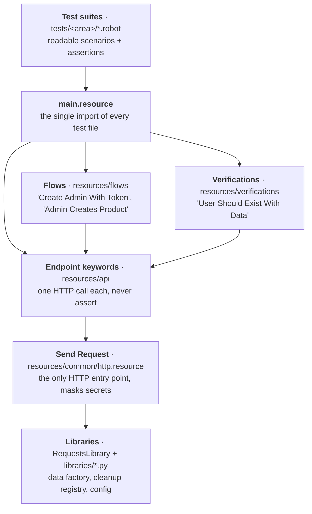

# ServeRest API Test Automation

<!-- CI badge added with the pipeline -->

API test automation for [ServeRest](https://github.com/ServeRest/ServeRest), an open-source REST API
that simulates an online store. Built with **Robot Framework** and **RequestsLibrary**.

📋 **[Read the test plan](docs/test-plan.md)**: 127 test cases (positive, negative, edge, contract,
security, end-to-end), the test design behind them, and the defects found.

## What this project shows

- **A test plan based on evidence.** Scenarios come from the Swagger, the ServeRest source code, and
  probing the running API. Every expected result was confirmed against ServeRest 3.2.2.
- **Real defects found**, including two critical ones:
  - **Overselling:** a cart with the same product in non-adjacent positions bypasses the duplicate
    check. A cart holding 8 units was accepted for a product with only 5 in stock.
  - **Password search:** `GET /usuarios?password=...` finds users by partial password match, with no
    authentication.

  All findings, with steps to reproduce: [test plan, section 9](docs/test-plan.md#9-findings).
- **A layered framework**: tests → business flows → endpoint keywords → libraries.
  See [architecture](docs/architecture.md).
- **Test data that cleans up after itself.** Every test creates its own users and products and
  deletes them, even when the test fails. Data is unique per parallel worker and replayable by seed.
- **No secrets in reports.** Passwords and tokens are masked in `log.html`.
- **Reproducible runs.** ServeRest, Python, and every dependency are pinned.

## How the tests were designed

### 1. Start from risk, not from endpoints

Before listing endpoints, I asked what would hurt a real online store: **charging the wrong
amount, selling stock that doesn't exist, exposing customer data, and letting the wrong person
change things**. Those four risks decided the priorities. Every money and stock rule is Critical
or High; cosmetic validation messages are Low.

### 2. Don't trust a single source

The Swagger describes what the API *should* do. It doesn't say what the API *actually* does,
and it leaves out most validation rules. So expected results come from three sources, and
**any disagreement between them is a finding, not a typo**:

| Source | What it gave me |
|---|---|
| Swagger | Routes, status codes, response shapes |
| Source code (ServeRest 3.2.2) | Validation rules, business logic, and *where* defects are likely |
| The running API | The truth. Every rule was confirmed live before it became a test case. |

That's how the plan found 4 places where the Swagger and the API disagree. For example, the Swagger
documents `idCarrinho`, but the API returns `idCarrinhos`.

### 3. Read the code to form hypotheses, then try to break them

Reading the source isn't about copying its rules into tests. It's about spotting code that
*looks* fragile, and then proving or disproving it against the running API:

| What I noticed in the code | Hypothesis | Result |
|---|---|---|
| The duplicate-product check calls `.sort()` on an array of objects, then compares only neighbors | Sorting objects does nothing, so `[A, B, A]` slips through | **Confirmed, critical.** A cart with 8 units was accepted for a product with 5 in stock, and stock dropped by only 4. |
| Stock updates read every quantity from one snapshot | Two lines for the same product overwrite each other instead of adding up | **Confirmed.** It's the second half of the same oversell bug. |
| User filters turn `nome` **and `password`** into case-insensitive regex searches | Anyone can search users by part of their password | **Confirmed, critical** |
| The token stores email + password, and the admin role is read from the database on every request | Changing the password should kill old tokens; demoting an admin should take effect immediately | **Confirmed.** Both behave correctly: TOK-08 and TOK-09 guard them. |
| Product names are trimmed, but there's no "not blank" rule | `"   "` becomes a product with an empty name | **Confirmed** |

Not every hypothesis is a bug. Confirming that something works (forged JWTs are rejected,
a failed cart reserves nothing) is just as valuable, because it becomes a regression test.

### 4. Assert what's right, not what happens today

When ServeRest returns passwords in plain text, the test asserts that **it shouldn't**, rather
than documenting the current behavior as "expected". These tests are tagged `known-defect`:
they appear as SKIP in the report, with the reason, and never block the pipeline. If a future
version fixes the bug, the test starts passing without any change.

### 5. Use techniques on purpose

| Technique | Applied to |
|---|---|
| Equivalence partitioning | Valid vs invalid emails, roles, IDs, numeric fields |
| Boundary values | Price 0 / 1 / 2⁵³−1 / 2⁵³+1, cart quantity = stock / stock + 1, ID length 15 / 16 / 17 |
| Decision table | Every route × persona (anonymous, customer, admin) → expected status |
| State transition | Cart lifecycle (create → conclude / cancel) and its effect on stock; token lifecycle |
| Contract testing | Strict JSON Schemas for every response shape |
| Error guessing | Out-of-order duplicates, blank names, regex search on sensitive fields |

### 6. Make the tests trustworthy

A test suite is only useful if its failures mean something:

- **Each test creates and deletes its own data.** The first version leaked 2 users when a test
  failed halfway, because cleanup was registered too late. Now every record is registered the moment
  the API returns its ID, and a test that fails on purpose proves nothing is left behind.
- **Emails use `@example.com`**, a domain reserved for examples. `@example.test` would be the
  textbook choice, but probing showed ServeRest rejects it.
- **No secrets in reports.** Passwords and tokens are masked, because test logs get shared.

### What's deliberately out of scope

Load testing (ServeRest's public instance forbids it), race conditions between two buyers (they
need a different tool), and the web UI. Each one is a conscious decision, listed in the
[test plan](docs/test-plan.md#1-objective-and-scope).

## Run the tests

You only need **Docker**:

```bash
git clone https://github.com/dmacedo-qa/serverest-robot-automation.git
cd serverest-robot-automation
docker compose run --rm tests
```

This starts ServeRest, waits until it's healthy, runs the suite, and writes the reports to
`results/`. Open **`results/report.html`** for the summary and **`results/log.html`** for the
details of each request. When you're done, run `docker compose down`.

The test image is built on the first run. After changing the code, add `--build`
(`docker compose run --rm --build tests`) so the container picks up the changes.

### Run a subset with tags

Every test is tagged by execution level, type, priority, and area. A pre-run check
(`libraries/tag_policy.py`) fails any test that is missing its type, priority, or ID tag, so
filters never skip a test by accident.

| To run | Command |
|---|---|
| Smoke (critical path) | `docker compose run --rm tests --include smoke tests` |
| Full regression | `docker compose run --rm tests` |
| Only positive / negative / edge cases | `docker compose run --rm tests --include negative tests` |
| Contract or security tests | `docker compose run --rm tests --include security tests` |
| By priority | `docker compose run --rm tests --include priority:critical tests` |
| One area | `docker compose run --rm tests --include carts tests` |
| Combined | `docker compose run --rm tests --include cartsANDnegative tests` |
| Open defects only | `docker compose run --rm tests --include known-defect tests` |

| Group | Tags | Where it comes from |
|---|---|---|
| Execution | `smoke`, `regression` | `regression` is automatic (`tests/__init__.robot`). `smoke` is set on the test. |
| Type | `positive`, `negative`, `edge`, `contract`, `security`, `e2e` | On the test. Exactly one, required. |
| Priority | `priority:critical`, `priority:high`, `priority:medium`, `priority:low` | On the test. Exactly one, required. |
| Area | `auth`, `users`, `products`, `carts`, `platform` | Automatic: the folder's `__init__.robot` |
| Status | `known-defect` | On the test. Shown as SKIP, never blocks a run. |
| ID | `AUTH-01`, `CRT-12`, … | On the test. Required. Links the report to the test plan. |

Only 3 cases are automated so far, all positive. Filters for types that have no automated tests
yet (for example `--include negative`) stop with *"contains no tests matching tag"* until those
cases are added.

<details>
<summary>Run without Docker for the tests (Python 3.13)</summary>

ServeRest still needs to be running, either with `docker compose up -d serverest` or with
`npx serverest@3.2.2 --nodoc` (Node.js).

```bash
python3.13 -m venv .venv
source .venv/bin/activate
pip install -r requirements.txt

robot --argumentfile config/robot.args tests/                         # everything
robot --argumentfile config/robot.args --include smoke tests/         # smoke only
pabot --processes 4 --argumentfile config/robot.args tests/           # in parallel
robot --argumentfile config/robot.args --variable DATA_SEED:81714172 tests/   # replay a run's data
robocop check resources tests                                         # lint
```

The virtual environment must be active for pabot, because it starts its workers with the
`python` on the `PATH`.
</details>

## Project map

How a test reaches the API. Each layer only talks to the one below it:



Full design rules and an example across all layers: [docs/architecture.md](docs/architecture.md).

## Project structure

```
serverest-robot-automation/
├── tests/
│   ├── __init__.robot         # for every suite: HTTP session, cleanup after each test, `regression` tag
│   ├── auth/                  # each area folder has an __init__.robot that sets its area tag
│   ├── users/
│   └── products/              # carts/, platform/, contract/, e2e/ are added with their tests
├── resources/
│   ├── main.resource          # single import used by every test file
│   ├── api/                   # endpoint keywords: login, users, products, carts (no assertions)
│   ├── flows/                 # business steps built from endpoint keywords
│   ├── verifications/         # assertion keywords
│   └── common/                # HTTP entry point (secret masking), setup and teardown
├── libraries/                 # Python: config loader, data factory, cleanup registry, HTTP helpers, tag policy
├── data/messages.yaml         # every expected API message, verbatim
├── config/
│   ├── dev.yaml, ci.yaml      # environment settings (URL, timeouts)
│   └── robot.args             # shared robot options: output, tag policy, known-defect handling
├── docs/                      # test plan and architecture
├── Dockerfile                 # test-runner image
├── docker-compose.yml         # ServeRest (pinned) + test runner
├── requirements.txt           # pinned Python dependencies
├── pyproject.toml             # Robocop lint settings
└── robot.toml                 # IDE support (RobotCode extension)
```

## Add a new test

1. Pick the area folder in `tests/` that matches the test-plan ID (USR → `users/`, CRT → `carts/`).
   A new area folder needs a two-line `__init__.robot` with its `Test Tags`.
2. Import only `main.resource`. Setup, cleanup, and the area tag are inherited:

   ```robotframework
   *** Settings ***
   Documentation       Users: duplicate email.
   Resource            ../../resources/main.resource

   *** Test Cases ***
   USR-10 Duplicate Email Is Rejected
       [Tags]    USR-10    negative    priority:critical
       ${user}=         Register User
       ${duplicate}=    Generate User    email=${user}[email]
       ${response}=     POST User    ${duplicate}
       Register Response For Cleanup    user    ${response}    # in case the API wrongly accepts it

       Status Should Be    400    ${response}
       Response Message Should Be    ${response}    ${MSG.users.email_taken}
   ```

3. Tag it with its ID, exactly one type, and exactly one priority, matching the test plan.
   Run `robocop check resources tests` before committing.

## Status

| | |
|---|---|
| Test plan | ✅ Complete: 127 cases |
| Framework | ✅ Data factory, cleanup, secret masking, tag policy, parallel runs, Docker runner |
| Automated | 3 of 127 cases (AUTH-01, USR-01, PRD-01). The rest are being added area by area. |
| CI | Next: GitHub Actions with smoke tests on every PR and the full suite nightly |

## Tech stack

Robot Framework 7.5 · RequestsLibrary 0.9.7 · pabot · Faker · Docker ·
ServeRest 3.2.2 (`paulogoncalvesbh/serverest`)

## Disclaimer

Personal portfolio project. All test data is synthetic and generated at runtime. ServeRest is an
open-source project by Paulo Gonçalves and is not affiliated with this project.
