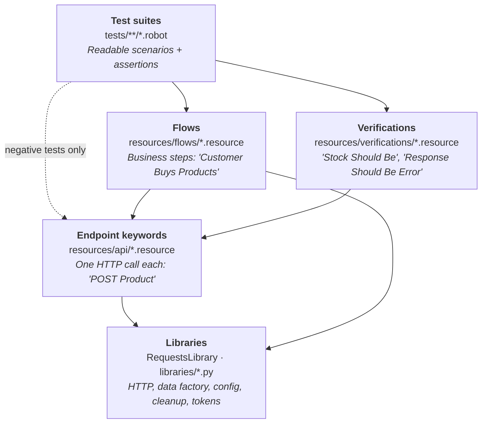

# Architecture

This document explains how the framework is organized and the rules that keep it maintainable.
It's the API-testing equivalent of the Page Object pattern. Endpoints play the role of pages.

## 1. Layers



| Layer | Knows about | Example | Asserts? |
|---|---|---|---|
| **Test suite** | Business language only | `Customer Creates Cart With    ${products}` | Yes: the outcome of the scenario |
| **Flow** | Which endpoints make up a business step | `Create Customer With Token` = generate user → `POST User` → `POST Login` | Only that setup steps succeeded (fail fast) |
| **Verification** | How to prove a fact | `Product Stock Should Be    ${id}    8` | Yes, that is its only job |
| **Endpoint keyword** | Path, method, payload shape, headers | `POST Product    ${payload}    ${token}` | **No.** Returns the response. |
| **Library** | HTTP, data generation, config, cleanup | `Generate Product`, `Register Response For Cleanup` | No |

### Why endpoint keywords never assert

The same call is used by positive and negative tests. `POST Product` must be able to return a
`403` so that PRD-07 can check it. If the endpoint keyword checked for `201`, every negative test
would need a second copy of the call. So:

- Endpoint keywords send the request with `expected_status=anything` and return the response.
- Flow keywords check for success, because they are used for setup, and a broken setup should
  fail immediately with a clear message, not three steps later.
- Tests and verification keywords make the assertions that matter for the scenario.

## 2. Rules

1. **Paths and payload shapes live only in `resources/api/`.** A test never contains `/produtos`
   or builds a JSON body by hand.
2. **All HTTP goes through `Send Request`** (`resources/common/http.resource`). No `POST On Session`
   anywhere else. This is what keeps secrets out of the log (section 4).
3. **Endpoint keywords do one HTTP call. Flows combine them.**
4. **Assertions live in tests or in `resources/verifications/`.**
5. **Tests may call endpoint keywords directly when the raw response is what they test**: negative
   tests, and single-endpoint checks like AUTH-01 or USR-01. They still use generated data and
   verification keywords.
6. **No hard-coded test data in tests.** Values come from the data factory (dynamic) or from
   `data/*.yaml` (static negative sets and expected messages).
7. **Every create request is registered for cleanup immediately**, before any assertion, with
   `Register Response For Cleanup`. A failing check later in the test, or an API defect that creates
   a record in a negative test, never leaves data behind.
8. **Shared setup is declared once, never per file.** Test files import only
   `resources/main.resource`. Session setup, cleanup teardown, and the `regression` tag live in
   `tests/__init__.robot`; each area folder's `__init__.robot` sets its area tag. A new test file
   needs one import line and can't forget the setup, the cleanup, or its area tag.

## 3. Example across the layers

**Endpoint keyword** (`resources/api/products.resource`): one call, no assertion.

```robotframework
*** Variables ***
${PRODUCTS_PATH}    /produtos

*** Keywords ***
POST Product
    [Documentation]    Sends POST /produtos and returns the response, whatever its status.
    [Arguments]    ${payload}    ${token}=${NONE}
    ${response}=    Send Request    POST    ${PRODUCTS_PATH}    token=${token}    json=${payload}
    RETURN    ${response}
```

**Flow** (`resources/flows/catalog.resource`): a business step that must succeed.

```robotframework
*** Keywords ***
Admin Creates Product
    [Documentation]    Creates a product as admin and registers it for cleanup.
    [Arguments]    ${admin_token}    &{overrides}
    ${product}=    Generate Product    &{overrides}
    ${response}=    POST Product    ${product}    ${admin_token}
    Register Response For Cleanup    product    ${response}    ${admin_token}
    Status Should Be    201    ${response}    msg=Setup failed: could not create product
    Set To Dictionary    ${product}    _id=${response.json()}[_id]
    RETURN    ${product}
```

**Test** (`tests/carts/create_cart.robot`, Phase 5): reads like the scenario in the test plan.

```robotframework
*** Test Cases ***
CRT-01 Creating A Cart Reserves Stock And Calculates Totals
    [Tags]    CRT-01    carts    smoke    regression
    ${admin}=       Create Admin With Token
    ${customer}=    Create Customer With Token
    ${mouse}=       Admin Creates Product    ${admin}[token]    preco=100    quantidade=10
    ${pad}=         Admin Creates Product    ${admin}[token]    preco=30     quantidade=5

    ${items}=    Cart Items    ${mouse}    2    ${pad}    1
    ${cart}=     Customer Creates Cart    ${customer}[token]    ${items}

    Cart Totals Should Be       ${cart}[_id]    preco_total=230    quantidade_total=3
    Product Stock Should Be     ${mouse}[_id]    8
    Product Stock Should Be     ${pad}[_id]      4
```

## 4. Cross-cutting components

| Component | Where | Responsibility |
|---|---|---|
| **Config loader** | `libraries/config_loader.py` | Reads `config/<env>.yaml` and exposes values such as `${BASE_URL}` as Robot variables. Environment variables override YAML. The environment is chosen with `ENV` (default `dev`). |
| **Data factory** | `libraries/data_factory.py` | Builds users and products with Faker, using defaults plus overrides. Unique values use the run ID and the pabot worker ID. Seeded and replayable with `DATA_SEED`. |
| **Cleanup registry** | `libraries/cleanup_registry.py` | Records what each test (or suite setup) created, as soon as the API returns an `_id`. Teardown deletes in dependency order: carts → products → users. Best-effort: failures become warnings. |
| **HTTP helpers** | `libraries/http_helpers.py` | Builds auth headers, reveals `Secret` values only inside `Send Request`, and logs a masked summary of each exchange |
| **Record assertions** | `libraries/record_assertions.py` | Compares a record read from the API with the payload that created it, without ever printing secrets |
| **Token handling** | `resources/flows/accounts.resource` | Logs in per persona and keeps the token as a `Secret`. Re-login before the 600 s expiry is planned for when a suite runs long enough to need it. |
| **Messages** | `data/messages.yaml` | Every expected ServeRest message, verbatim, under an English key, for example `users.email_taken: "Este email já está sendo usado"` |
| **Negative data sets** | `data/negative/*.yaml` | Invalid payloads and their expected field errors. They drive data-driven tests (`[Template]`). |
| **Session setup** | `resources/common/setup.resource`, used by `tests/__init__.robot` | Creates the `serverest` HTTP session once per run (once per process under pabot), logs the run ID and seed, and runs the cleanup teardown after every test |

### Sensitive values in logs

Passwords and tokens must never appear in `log.html` or `output.xml`. Two mechanisms work together:

1. **`Secret` values (Robot Framework 7.4+).** The data factory wraps every password in a `Secret`,
   and login returns the token as a `Secret`. Robot logs these as `<secret>`, including when they
   are assigned to variables or passed between keywords.
2. **One masked HTTP entry point.** RequestsLibrary logs full requests and responses. `Send Request`
   sets the log level to `WARN` during the call, reveals the secrets only there, and then logs its
   own summary with `password` and `authorization` replaced by `***`:

```
POST http://localhost:3000/login → 200 (26 ms)
Request body: { "email": "qa.2s0x.w0.n001@example.com", "password": "***" }
Response body: { "message": "Login realizado com sucesso", "authorization": "***" }
```

Verified by searching `output.xml` after a run: no `Bearer ey…` strings and no unmasked `password` fields.

## 5. Configuration

```
config/dev.yaml   → local work (docker compose or npx)
config/ci.yaml    → GitHub Actions
```

Precedence, highest first:

1. Command line: `--variable BASE_URL:http://...`
2. Environment variables (for example `BASE_URL`, set by `docker-compose.yml` for the test container)
3. `config/<ENV>.yaml`

Run options that are the same for everyone (output folder, log level, tag statistics) live in
`config/robot.args`, so the everyday command stays short:

```bash
robot --argumentfile config/robot.args --include smoke tests/
```

## 6. Parallel execution

Suites run in parallel with pabot (`pabot --processes 4 ...`). The design is parallel-safe because:

- Every test creates its own users and products with globally unique emails and names.
- Unique values include the pabot worker ID (the `${PABOTEXECUTIONPOOLID}` variable that pabot sets;
  it falls back to `0` in a normal `robot` run).
- No test uses ServeRest's seed records.
- Stock is only asserted on products that the same test created.

Each pabot worker is a separate process, so each one logs its own seed and run ID. `DATA_SEED`
applies the same seed to every worker. To replay one suite's data, run that suite alone with the
seed its log shows.

pabot starts workers with the `python` on the `PATH`, so **the virtual environment must be
activated** (`source .venv/bin/activate`). Calling `.venv/bin/pabot` without activating it makes
the workers run on the system Python, without the project's packages.

## 7. Folder structure

```
serverest-robot-automation/
├── config/
│   ├── dev.yaml               # local settings
│   ├── ci.yaml                # CI settings
│   └── robot.args             # shared robot command-line options
├── data/
│   ├── messages.yaml          # expected ServeRest messages (verbatim)
│   └── negative/              # invalid payload sets for data-driven tests
├── docs/
│   ├── test-plan.md
│   └── architecture.md
├── libraries/                 # custom Python: config, data factory, cleanup, tag policy
├── resources/
│   ├── main.resource          # the single import used by test files
│   ├── api/                   # endpoint keywords: login, users, products, carts
│   ├── flows/                 # business keywords
│   ├── verifications/         # assertion keywords
│   └── common/                # session setup, teardown, shared helpers
├── tests/
│   ├── __init__.robot         # session setup/teardown, cleanup, `regression` tag (all suites)
│   ├── auth/                  # AUTH-*, TOK-*, SEC-02, SEC-08 (+ __init__.robot: area tag)
│   ├── users/                 # USR-*, SEC-01/03/04/07, DQ-01/04/09/10
│   ├── products/              # PRD-*, DQ-02/03/05
│   ├── carts/                 # CRT-*, DQ-06/07/08
│   ├── platform/              # PLT-*
│   ├── contract/              # CON-*, DRIFT-*
│   └── e2e/                   # E2E-*
├── Dockerfile                 # test-runner image
├── docker-compose.yml         # ServeRest + test runner
├── requirements.txt
├── pyproject.toml             # Robocop lint and format settings
└── robot.toml                 # lets the RobotCode IDE extension resolve libraries and config
```

**Folder = area, tag = type.** A security or data-quality finding lives in the folder of the
functionality it affects (SEC-01, passwords in the user listing, is in `tests/users/`), so everything
about one area is in one place. Type, priority, and execution tags (`negative`, `priority:high`,
`smoke`, …) cut across folders, and `libraries/tag_policy.py` makes sure every test has them.

## 8. Naming conventions

| Item | Convention | Example |
|---|---|---|
| Test case | `<ID> <Behavior in plain English>` | `USR-02 Duplicate Email Is Rejected` |
| Endpoint keyword | `<METHOD> <Resource>` | `GET Product By Id`, `DELETE User` |
| Flow keyword | Actor + action | `Customer Creates Cart`, `Admin Creates Product` |
| Verification keyword | `… Should …` | `Product Stock Should Be`, `Response Should Have Field Error` |
| Variables | `${UPPER_SNAKE}` for constants and paths, `${lower_snake}` for local values | `${USERS_PATH}`, `${customer}` |
| Files | `snake_case.robot` / `snake_case.resource` | `create_cart.robot`, `products.resource` |
