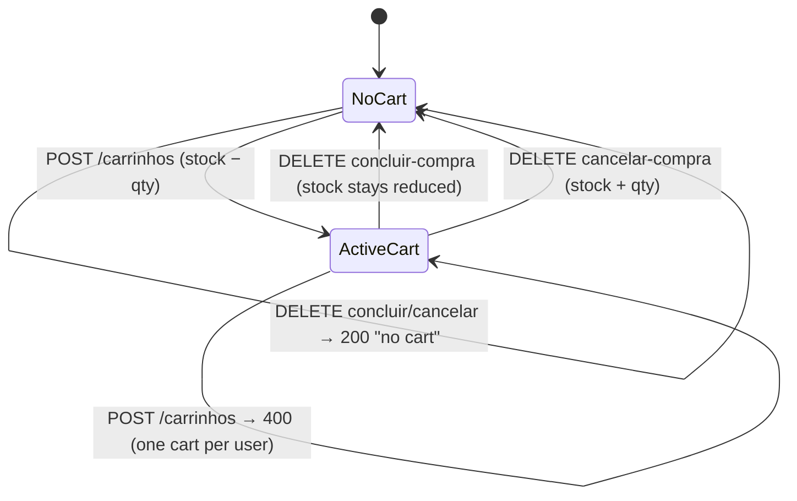

# Test Plan: ServeRest API

| | |
|---|---|
| System under test | [ServeRest](https://github.com/ServeRest/ServeRest) 3.2.2, an open-source REST API that simulates an online store |
| Runtime | Docker image `paulogoncalvesbh/serverest:3.2.2`, pinned by digest |
| Tooling | Robot Framework 7.5 · RequestsLibrary · JSON Schema · pabot |
| Version | 1.0 (2026-10-10) |

## Summary

127 test cases across 8 areas. Every expected result was checked against a running ServeRest 3.2.2,
not copied from the documentation. 83 cases are automated today, including the critical and high
findings below; the *Automated* column in section 8 shows which.

| Area | Positive | Negative | Edge | Contract | Security | Total |
|---|---:|---:|---:|---:|---:|---:|
| Authentication and tokens | 4 | 9 | 2 | – | 6 | 21 |
| Users | 9 | 7 | 7 | – | 4 | 27 |
| Products | 6 | 7 | 6 | – | – | 19 |
| Carts | 8 | 8 | 6 | – | – | 22 |
| Platform (HTTP layer) | 1 | 5 | – | – | 1 | 7 |
| Contract | – | – | – | 14 | – | 14 |
| Data quality and Swagger drift | – | 9 | 1 | 4 | – | 14 |
| End-to-end journeys | 3 | – | – | – | – | 3 |
| Total | 31 | 45 | 22 | 18 | 11 | 127 |

Findings so far (steps to reproduce in [section 9](#9-findings)):

| Severity | Finding |
|---|---|
| Critical | Overselling: a cart with the same product in non-adjacent positions bypasses the duplicate check. A cart holding 8 units was accepted for a product with 5 in stock, and stock dropped by only 4. |
| Critical | Password search: `GET /usuarios?password=abc` returns every user whose password contains "abc" (case-insensitive), without authentication. |
| High | Passwords returned in plain text by `GET /usuarios`, and embedded in the JWT payload |
| High | Anyone can register as admin, and update or delete any user, without a token |
| Medium | Blank names (`"   "`) accepted, case-sensitive uniqueness for emails and product names, numeric strings accepted as numbers |
| Medium | Swagger out of sync with the API in 4 places (field names, undocumented field, filter limits, status codes) |

---

## 1. Objective and scope

Verify the ServeRest REST API against its documented contract and its business rules, and find
defects that matter in a real store: wrong stock, wrong totals, data exposure, and broken access
control. The suite must run unattended in CI against a disposable local instance.

**In scope:** all routes under `/login`, `/usuarios`, `/produtos`, `/carrinhos`, and the cross-cutting
behavior of the HTTP layer (routing, error handling, security headers, `/version`).

**Out of scope:**

- The web front end (`front.serverest.dev`). This project is API only.
- Load and performance testing. ServeRest has its own guidance, and its public instance blocks load tests.
- Concurrency and race conditions (two customers buying the last unit at the same time). Worth
  testing, but it needs a different tool than functional API tests.
- The Swagger UI pages themselves (`/`, `/swagger-sw.js`, static assets)
- The public instance at `serverest.dev`. It's shared by everyone who studies with it.

## 2. Test basis

Expected results come from three sources, in this order of authority:

1. **Reasonable rules for a production store API** (for example "never return passwords"). Where
   ServeRest breaks one, the test asserts the correct rule and gets the `known-defect` tag.
2. **The Swagger** served by the instance (`GET /swagger.json`). Differences are contract findings.
3. **The ServeRest source code at tag 3.2.2** (validation schemas, controllers, middlewares), read
   to find undocumented rules and likely defects. Every rule taken from the code was then
   **confirmed by calling the running API** before it became a test case.

## 3. Test design techniques

| Technique | Where it's used |
|---|---|
| Equivalence partitioning | Valid vs invalid emails, roles, IDs, and numeric fields |
| Boundary value analysis | `preco` 0 / 1 / 2⁵³−1 / 2⁵³+1, `quantidade` −1 / 0, cart quantity = stock / stock + 1, ID length 15 / 16 / 17 |
| Decision table | The access matrix in section 4: persona × route → status |
| State transition | Cart lifecycle and stock (section 5). Token lifecycle: valid → expired / password changed / user deleted / role changed |
| Error guessing (source-assisted) | Duplicate products out of order, blank names, regex search on sensitive fields, upsert IDs |
| Contract testing | Strict JSON Schemas for every response shape, plus a check of the Swagger against real behavior |

## 4. Access control matrix

Expected status for each persona. **Admin** = `administrador: "true"`, **Customer** = `"false"`,
**Anonymous** = no token. Covered by TOK-11, PRD-07, PRD-08, CRT-14, SEC-03, and SEC-07.

| Route | Anonymous | Customer | Admin |
|---|:-:|:-:|:-:|
| `POST /login`, `GET` on any resource | 200 | 200 | 200 |
| `POST /usuarios` | 201 | 201 | 201 |
| `PUT` / `DELETE /usuarios/{id}` | 200 (should be 401, SEC-03) | 200 on *any* user | 200 |
| `POST` / `PUT` / `DELETE /produtos` | 401 | 403 | 201/200 |
| `POST /carrinhos`, `DELETE /carrinhos/*` | 401 | 201/200 | 201/200 |

## 5. Cart lifecycle and stock

While a cart is active, its user can't be deleted, and none of its products can be deleted.

## 6. Test data strategy

- **Every test owns its data.** Users and products are generated per test with Faker and deleted
  in teardown, in the order ServeRest allows: carts → products → users. A record is registered for
  cleanup as soon as the API returns its `_id`, so a failing test never leaves data behind.
- **Unique and parallel-safe.** Emails and product names include a run ID, the pabot worker ID, and
  a counter, for example `qa.k7f2.w3.n001@example.com`. `example.com` is reserved for documentation
  (RFC 2606), and ServeRest's validator accepts it, unlike `.test` domains.
- **Reproducible.** Generated content is seeded. The seed is logged, and `--variable DATA_SEED:<n>`
  replays it.
- **Static where meaning matters.** Invalid inputs are fixed rows in data-driven tests (Robot
  `[Template]`), right next to the test that uses them. Expected messages live in
  `data/messages.yaml`, kept verbatim in Portuguese, the
  language the API returns.
- **Never ServeRest's seed records.** The database starts with `fulano@qa.com`, 2 products, and 1
  cart. Tests don't read, change, or count them.
- **Secrets stay out of reports.** Passwords and tokens are masked in `log.html`.

## 7. Environments and criteria

| Environment | URL | Use |
|---|---|---|
| Local / CI | `http://localhost:3000` (Docker) | All tests |
| Short-token instance | `http://localhost:3001` (`--timeout 5`) | Token expiry only (TOK-06) |

**Entry criteria:** `GET /version` returns `3.2.2`, and the container image digest matches
`docker-compose.yml`.

**Exit criteria:**

- PR gate: 100 % of `smoke` tests pass.
- Nightly: 100 % of Critical and High tests pass, apart from tests tagged `known-defect`.
- No data is left behind: only ServeRest's seed records remain after a full run. The final
  teardown checks this and logs a warning listing any test user still present.
- Reports (`report.html`, `log.html`) are published as CI artifacts.

### Tags

Every test carries tags from each group below, so any slice of the suite can be run on its own.
A pre-run check (`libraries/tag_policy.py`) **fails any test that is missing its type, priority,
or ID tag**, so a test can't silently escape a filter.

| Group | Tags | Rule |
|---|---|---|
| Execution | `smoke`, `regression` | Every test is `regression`. `smoke` marks the critical path for PR checks. |
| Type | `positive`, `negative`, `edge`, `contract`, `security`, `e2e` | Exactly one, matching the Type column in section 8 |
| Priority | `priority:critical`, `priority:high`, `priority:medium`, `priority:low` | Exactly one, matching the Priority column |
| Area | `auth`, `users`, `products`, `carts`, `platform` | Set per suite |
| Automated | `known-defect` | The test asserts a rule ServeRest breaks today. Reported as SKIP, so it never blocks a run. |
| ID | `AUTH-01`, `CRT-12`, … | Traceability from the report back to this plan. Hidden from tag statistics. |

Examples: `--include smoke`, `--include negative`, `--include cartsANDpriority:critical`,
`--include known-defect` (all open findings), `--exclude known-defect` (only passing behavior).

---

## 8. Test cases

**Type:** P = positive · N = negative · E = edge/boundary · C = contract · S = security.
**Automated:** cases with *Yes* run in the suite today; the rest are planned. Data-driven cases run once per row of their data set.

### 8.1 Authentication and tokens

| ID | Scenario | Expected result | Type | Priority | Automated |
|---|---|---|:-:|:-:|:-:|
| AUTH-01 | Registered user logs in | 200, message, `authorization` = `Bearer <JWT>` | P | Critical | Yes |
| AUTH-02 | Admin logs in and uses the token on an admin route | 200, then `POST /produtos` → 201 | P | High | Yes |
| AUTH-03 | Customer's token works on a protected route | `DELETE /carrinhos/cancelar-compra` → 200 | P | High | Yes |
| AUTH-04 | Login accepts a form-urlencoded body | 200 and a token (undocumented but supported) | P | Low | Yes |
| AUTH-05 | Wrong password | 401 `Email e/ou senha inválidos` | N | Critical | Yes |
| AUTH-06 | Unknown email | 401 with the same message as AUTH-05, so accounts can't be enumerated | S | High | Yes |
| AUTH-07 | Invalid login body: missing email, missing password, blank email, blank password, invalid email format, non-string password, unknown field | 400 with one message per invalid field | N | High | Yes |
| AUTH-08 | Email in different case (`USER@...`) | 401: matching is exact (see DQ-01) | E | Low | Yes |
| TOK-01 | No `Authorization` header on a protected route | 401 `Token de acesso ausente...` | N | Critical | Yes |
| TOK-02 | Malformed header: `Bearer` alone, `bearer <jwt>`, `<jwt>` without prefix, `Bearer abc`, `Basic dXNlcg==` | 401 | N | High | Yes |
| TOK-03 | JWT signed with a different key | 401 | S | High | Yes |
| TOK-04 | JWT with `alg: none` | 401 | S | High | Yes |
| TOK-05 | JWT payload changed, original signature kept | 401 | S | High | Yes |
| TOK-06 | Token after it expires (5 s instance) | Valid at 0 s, 401 at 6 s | N | High | Yes |
| TOK-07 | Token of a user who was deleted | 401 | N | Medium | Yes |
| TOK-08 | Token after the user's password changed | 401 | N | Medium | Yes |
| TOK-09 | Admin demoted to customer: existing token on an admin route | 403 immediately (role is checked on every request) | N | High | Yes |
| TOK-10 | User's name changed: existing token | Still valid (only email + password are bound to the token) | E | Low | Yes |
| TOK-11 | Customer token on an admin route | 403 `Rota exclusiva para administradores` | N | Critical | Yes |
| SEC-02 | JWT payload must not contain the password | Fails today: payload has `email` and `password` | S | High | Yes (known defect) |
| SEC-08 | Security headers on every response | `X-Frame-Options`, `X-Content-Type-Options: nosniff`, `Strict-Transport-Security` present; `X-Powered-By` absent | S | Medium | Yes |

### 8.2 Users

| ID | Scenario | Expected result | Type | Priority | Automated |
|---|---|---|:-:|:-:|:-:|
| USR-01 | Create a customer, then an admin; read each back by ID | 201, then GET returns exactly the sent data | P | Critical | Yes |
| USR-02 | List users | `quantidade` equals the length of `usuarios` | P | Medium | Yes |
| USR-03 | Filter by `email` | Only that user | P | Medium | Yes |
| USR-04 | Filter by `nome` with part of the name, in another case | Matches (partial, case-insensitive) | P | Low | Yes |
| USR-05 | Filter by `administrador` | Only users with that role | P | Low | Yes |
| USR-06 | Combine filters (`nome` + `administrador`) | Only users matching both | P | Low | Yes |
| USR-07 | Update a user with PUT | 200 `Registro alterado com sucesso`; GET shows the new values | P | High | Yes |
| USR-08 | PUT keeping the user's own email | 200, not a false "email in use" | P | Medium | Yes |
| USR-09 | Delete a user without a cart | 200, then GET → 400 `Usuário não encontrado` | P | High | Yes |
| USR-10 | Create with an email already in use | 400 `Este email já está sendo usado`; no record created | N | Critical | Yes |
| USR-11 | PUT to another user's email | 400 `Este email já está sendo usado` | N | High | Yes |
| USR-12 | Invalid body: each field missing, each field blank, 4 invalid email formats, `administrador` = `"TRUE"` / `"yes"` / `true` (boolean), `nome` as a number, unknown field | 400 with the exact message for each field; no record created | N | High | Yes |
| USR-13 | GET by a well-formed ID that doesn't exist | 400 `Usuário não encontrado` | N | Medium | Yes |
| USR-14 | GET by a malformed ID: 15 chars, 17 chars, special characters | 400 `id deve ter exatamente 16 caracteres alfanuméricos` | N | Medium | Yes |
| USR-15 | Delete a user who has a cart | 400 with `idCarrinho`; user still exists | N | High | Yes |
| USR-16 | Invalid filters: `email=bad`, `administrador=TRUE`, unknown parameter | 400 with field message | N | Low | Yes |
| USR-17 | Delete an ID that doesn't exist | 200 `Nenhum registro excluído` (idempotent) | E | Low | Yes |
| USR-18 | PUT on an unknown ID | 201: creates a user, but with a new server-generated ID, not the one in the URL | E | Medium | Yes |
| USR-19 | Names with accents, apostrophes, and emoji (`João D'Ávila 😀`) | Stored and returned exactly | E | Medium | Yes |
| USR-20 | 300-character name | Accepted (no length limit) | E | Low | Yes |
| USR-21 | Email with plus-addressing and subdomain (`qa+tag@sub.example.com`) | Accepted | E | Low | Yes |
| USR-22 | Empty filter value (`?nome=`) | Ignored: returns the full list | E | Low | Yes |
| USR-23 | Body larger than 100 KB | 413 `Payload too large` | E | Low | Yes |
| SEC-01 | User listing must not expose passwords | Fails today: `password` in plain text | S | High | Yes (known defect) |
| SEC-03 | PUT and DELETE on users must require a token | Fails today: both work anonymously, on any user | S | High | Yes (known defect) |
| SEC-04 | Users must not be searchable by password | Fails today: `?password=` does a case-insensitive partial match | S | Critical | Yes (known defect) |
| SEC-07 | Self-registration must not grant admin | Fails today: anyone can create an admin account | S | High | Yes (known defect) |

### 8.3 Products

| ID | Scenario | Expected result | Type | Priority | Automated |
|---|---|---|:-:|:-:|:-:|
| PRD-01 | Admin creates a product; read it back by ID | 201, then GET returns exactly the sent data | P | Critical | Yes |
| PRD-02 | List products | `quantidade` equals the length of `produtos` | P | Medium | Yes |
| PRD-03 | Filters: `nome` (partial, case-insensitive), `descricao` (partial), `preco` (exact), `quantidade` (exact) | Only matching products | P | Low | Yes |
| PRD-04 | Update a product with PUT | 200; GET shows the new values | P | High | Yes |
| PRD-05 | Delete a product that isn't in a cart | 200, then GET → 400 `Produto não encontrado` | P | High | Yes |
| PRD-06 | Optional `imagem` field | Stored (trimmed) and returned. Not in the Swagger (DRIFT-02) | P | Low | Yes |
| PRD-07 | Customer calls POST, PUT, DELETE | 403 `Rota exclusiva para administradores`; nothing changes | N | Critical | Yes |
| PRD-08 | Anonymous calls POST, PUT, DELETE | 401; nothing changes | N | Critical | Yes |
| PRD-09 | Duplicate name, on create and on PUT rename | 400 `Já existe produto com esse nome` | N | High | Yes |
| PRD-10 | Invalid body: each field missing, blank `nome`/`descricao`, `preco` 0 / −1 / 1.5 / `"abc"`, `quantidade` −1 / 1.5, unknown field | 400 with the exact message per field | N | High | Yes |
| PRD-11 | Delete a product that is in a cart | 400 with `idCarrinhos`; product still exists | N | High | Yes |
| PRD-12 | GET by an unknown ID and by a malformed ID | 400 not found / 400 ID rule | N | Medium | Yes |
| PRD-13 | Invalid filters: `preco=abc`, `preco=0`, `quantidade=-1`, unknown parameter | 400 with field message | N | Low | Yes |
| PRD-14 | Boundaries: `preco` 1 ok, 9007199254740991 ok, 9007199254740993 rejected; `quantidade` 0 ok | Accepted / rejected with `preco não pode ser maior que 9007199254740991` | E | Medium | Yes |
| PRD-15 | Name with surrounding spaces | Stored trimmed; `" X "` conflicts with `"X"` | E | Low | Yes |
| PRD-16 | PUT keeping the product's own name | 200, not a false duplicate | E | Medium | Yes |
| PRD-17 | PUT on an unknown ID | 201 with a new server-generated ID | E | Low | Yes |
| PRD-18 | Delete an ID that doesn't exist | 200 `Nenhum registro excluído` | E | Low | Yes |
| PRD-19 | Product with stock 0 | Created; can't be added to a cart (CRT-20) | E | Low | Yes |

### 8.4 Carts

| ID | Scenario | Expected result | Type | Priority | Automated |
|---|---|---|:-:|:-:|:-:|
| CRT-01 | Create a cart with 2 products | 201; `precoTotal` = Σ price × qty; `quantidadeTotal` = Σ qty; each product's stock decreased | P | Critical | Yes |
| CRT-02 | Read the cart by ID | Items with `precoUnitario`; `idUsuario` = the token's owner | P | High |  |
| CRT-03 | List carts filtered by `idUsuario` | Only that user's cart | P | Low |  |
| CRT-04 | Conclude the purchase | 200; cart gone; stock stays reduced | P | Critical | Yes |
| CRT-05 | Cancel the purchase | 200 `...Estoque dos produtos reabastecido`; cart gone; stock restored exactly | P | Critical | Yes |
| CRT-06 | New cart after concluding a purchase | 201 (the one-cart rule only covers active carts) | P | Medium |  |
| CRT-07 | Admin creates a cart | 201 (any authenticated user can buy) | P | Low |  |
| CRT-08 | Buy exactly the remaining stock | 201; stock becomes 0 | P | High |  |
| CRT-09 | Second cart for the same user | 400 `Não é permitido ter mais de 1 carrinho` | N | High | Yes |
| CRT-10 | Invalid body: empty list, `produtos` not an array, item missing fields, quantity 0 / −1 / 1.5, unknown item field | 400 with the exact message; stock unchanged | N | High |  |
| CRT-11 | One valid and one unknown product | 400 `Produto não encontrado` with `item.index`; the valid product's stock is unchanged | N | High |  |
| CRT-12 | Quantity above stock | 400 with `quantidadeEstoque`; nothing reserved | N | Critical | Yes |
| CRT-13 | Same product twice, next to each other | 400 `Não é permitido possuir produto duplicado` with `idProdutosDuplicados` | N | High |  |
| CRT-14 | Anonymous: create, conclude, cancel | 401 | N | High |  |
| CRT-15 | GET by an unknown ID and by a malformed ID | 400 not found / 400 ID rule | N | Medium |  |
| CRT-16 | Invalid filters: `precoTotal=0`, `quantidadeTotal=-1`, `precoTotal=abc` | 400 with field message | N | Low |  |
| CRT-17 | Conclude or cancel without a cart | 200 `Não foi encontrado carrinho para esse usuário` | E | Low |  |
| CRT-18 | Product price changes after the cart was created | Cart keeps the price from creation time | E | High |  |
| CRT-19 | Product stock edited while in a cart, then the cart is cancelled | Cancelled quantity is added to the *current* stock (edited to 50, cancel 2 → 52) | E | Medium |  |
| CRT-20 | Product with stock 0 | 400 `Produto não possui quantidade suficiente` | E | Medium |  |
| CRT-21 | Cart with 10 different products | Totals correct for all 10 | E | Medium |  |
| CRT-22 | Quantity equal to stock + 1 | 400 (boundary next to CRT-08) | E | High |  |

### 8.5 Platform (HTTP layer)

| ID | Scenario | Expected result | Type | Priority | Automated |
|---|---|---|:-:|:-:|:-:|
| PLT-01 | `GET /version` | 200 `{"version": "3.2.2"}`. Also the entry criterion. | P | High |  |
| PLT-02 | Unknown route (`GET /pedidos`) | 405 with a message naming the method and path | N | Low |  |
| PLT-03 | Unsupported method (`PATCH /usuarios`) | 405 | N | Low |  |
| PLT-04 | Malformed JSON on each write route | 400 `Adicione aspas em todos os valores...` | N | Medium |  |
| PLT-05 | Invalid percent-encoding in the URL | 400 `Parâmetro de URL inválido...` | N | Low |  |
| PLT-06 | Body larger than 100 KB | 413 | N | Low |  |
| PLT-07 | CORS | `Access-Control-Allow-Origin: *` on responses | S | Low |  |

### 8.6 Contract

Every response shape has a strict JSON Schema (required fields, types, no unexpected fields, `_id`
matches `^[a-zA-Z0-9]{16}$`). Contract tests call each route and validate the response against it.

| ID | Route | Responses validated | Type | Priority | Automated |
|---|---|---|:-:|:-:|:-:|
| CON-01 | `POST /login` | 200, 400, 401 | C | High | Yes |
| CON-02 | `GET /usuarios` | 200 list, 400 | C | High |  |
| CON-03 | `GET /usuarios/{id}` | 200, 400 | C | High |  |
| CON-04 | `POST`, `PUT`, `DELETE /usuarios` | 201, 200, 400 | C | High |  |
| CON-05 | `GET /produtos` | 200 list, 400 | C | High |  |
| CON-06 | `GET /produtos/{id}` | 200, 400 | C | High |  |
| CON-07 | `POST`, `PUT`, `DELETE /produtos` | 201, 200, 400, 401, 403 | C | High |  |
| CON-08 | `GET /carrinhos` | 200 list, 400 | C | High |  |
| CON-09 | `GET /carrinhos/{id}` | 200, 400 | C | High | Yes |
| CON-10 | `POST /carrinhos` | 201; 400 variants (`item` + `index`, `idProdutosDuplicados`) | C | High |  |
| CON-11 | `DELETE /carrinhos/*` | 200, 401 | C | Medium |  |
| CON-12 | Any validation error | Body is an object of `field → message` | C | Medium |  |
| CON-13 | Every response | `Content-Type: application/json; charset=utf-8` | C | Low |  |
| CON-14 | `GET /version`, 405 and 413 responses | Shape is stable | C | Low |  |

### 8.7 Data quality and Swagger drift

These assert the correct behavior. All of them fail on 3.2.2 and carry `known-defect`, so they
show up in reports without blocking the pipeline.

| ID | Expected rule | Observed on 3.2.2 | Type | Priority | Automated |
|---|---|---|:-:|:-:|:-:|
| DQ-01 | Email uniqueness ignores case | `ADM@x.com` and `adm@x.com` are separate accounts | N | Medium | Yes |
| DQ-02 | Product name uniqueness ignores case | `Mouse X` and `MOUSE X` both accepted | N | Medium | Yes (known defect) |
| DQ-03 | `preco` must be a JSON number | `"10"` and `"1e2"` accepted and converted | N | Low | Yes (known defect) |
| DQ-04 | User `nome` can't be blank | `"   "` accepted | N | Medium | Yes (known defect) |
| DQ-05 | Product `nome` can't be blank | `"   "` accepted and stored as `""` | N | Medium | Yes (known defect) |
| DQ-06 | Cart `quantidade` must be a JSON number | `"2"` accepted | N | Low |  |
| DQ-07 | A cart can't contain the same product twice | `[A, B, A]` accepted: the cart holds 8 units of A (stock 5), and stock drops by only 4 | N | Critical | Yes |
| DQ-08 | Stock never goes below what's actually sold | Consequence of DQ-07: concluding that cart sells 8 units while stock shows 1 | N | Critical |  |
| DQ-09 | ID validation is consistent across verbs | GET rejects malformed IDs; PUT and DELETE on `/usuarios` accept them, and PUT creates a user | N | Low | Yes (known defect) |
| DQ-10 | PUT on an unknown ID either updates that ID or returns 404 | Creates a record with a *different* ID (USR-18, PRD-17) | E | Low | Yes (known defect) |
| DRIFT-01 | Swagger field name matches the API | Delete product in cart: Swagger says `idCarrinho`, API returns `idCarrinhos` | C | Medium |  |
| DRIFT-02 | Every accepted field is documented | Products accept and return `imagem`, which the Swagger doesn't list | C | Low |  |
| DRIFT-03 | Documented filter limits match the API | Swagger: `quantidadeTotal ≥ 0`. API: rejects 0 | C | Low |  |
| DRIFT-04 | Every returned status code is documented | 405, 413, and malformed-JSON 400 aren't in the Swagger | C | Low |  |

### 8.8 End-to-end journeys

| ID | Journey | Type | Priority | Automated |
|---|---|:-:|:-:|:-:|
| E2E-01 | Admin creates 2 products → customer registers and logs in → creates a cart → totals and stock checked → concludes → stock final, cart gone | P | Critical | Yes |
| E2E-02 | Same journey, but the customer cancels → stock fully restored → the customer can now be deleted | P | High |  |
| E2E-03 | Admin can't delete a product while it's in a cart → customer concludes → admin deletes it successfully | P | High |  |

---

## 9. Findings

Defects are reported with evidence in the test log. The two critical ones, with steps to reproduce:

**DQ-07 / DQ-08: overselling through non-adjacent duplicates**

1. Admin creates product A with `quantidade: 5`, and product B.
2. Customer `POST /carrinhos` with `[{A, 4}, {B, 1}, {A, 4}]`.
3. **Expected:** 400 `Não é permitido possuir produto duplicado`.
   **Actual:** 201. The cart holds 8 units of A, `precoTotal` counts all 8, and A's stock is 1.

Root cause, from the source: the duplicate check sorts an array of objects, which doesn't
reorder them, and then only compares neighbors. The stock update reads all quantities from one
snapshot, so the second line for A overwrites the first instead of adding to it.

**SEC-04: user search by password**

1. `GET /usuarios?password=pw1`, with no token.
2. **Expected:** 400 (`password` isn't a valid filter), or the filter is ignored.
   **Actual:** 200 with every user whose password *contains* `pw1`, in any case. Combined with
   SEC-01, this returns the full password.

## 10. Risks

| Risk | Mitigation |
|---|---|
| A ServeRest upgrade changes rules or messages | Image pinned by version and digest. Messages kept in one file. Upgrades get their own PR. |
| Swagger and API disagree | The test basis is explicit (section 2). Differences become DRIFT findings. |
| Data collisions in parallel runs | Per-test data with unique, worker-tagged values |
| Leftover data | Cleanup registered before any assertion. Exit criterion checks only seed data remains. |
| Defects block CI | `known-defect` tag with `--skiponfailure`: visible in the report, not blocking |
| Token expiry during long runs | Suites run in seconds. Expiry itself is tested on a separate 5 s instance. |
